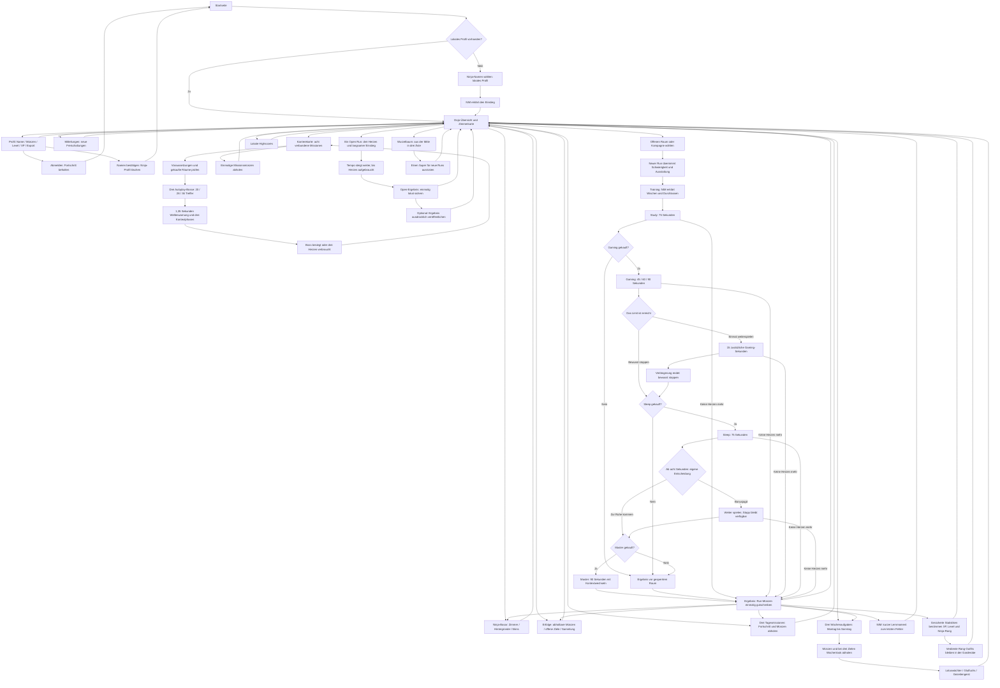
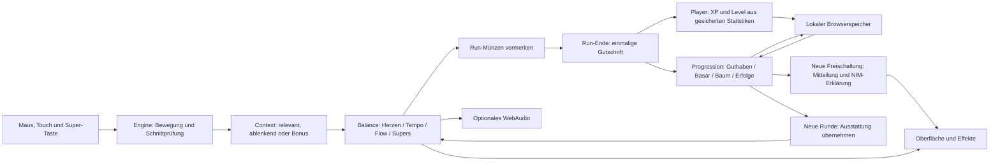

# Notification Ninja: Ablauf und Weiterentwicklung

Diese Übersicht dokumentiert den Spielablauf von Version 1.8.1 und ordnet die technischen Aufgaben. Der Zeitplan am Ende ist ein **anpassbares Beispiel für Weiterentwicklung**. Seine Daten sind keine vereinbarte Projektfrist.

## Ablauf der Bildschirme

Das Diagramm zeigt den Einstieg, Open Run und die Kampagne. Die Startseite führt zu einem neuen oder bereits vorhandenen lokalen Ninja-Profil; Abmelden erhält den Spielstand. Umbenennen ändert nur den Namen. Zum endgültigen Löschen muss der aktuelle Name bestätigt werden; vorhandene Online-Einträge werden zuerst entfernt. Die Dojo-Übersicht bündelt Profil, Level, XP, Münzen und das nächste Ziel. Die Profil-Garderobe zeigt tatsächlich gekaufte und ausgewählte Ninja-Looks. Der eigene Ninja übernimmt im Spielfeld die Wurfanimation. Die feste Zurück-Schaltfläche stellt die vorherige Ansicht und ihre Scrollposition wieder her.

Das Spielfeld zeigt ein größeres Ninja-Team um die Mitte: ein Werfer auf Entspannt, zwei auf Normal und drei auf Profi. Jeder trägt den beim Run-Start ausgewählten Look. Gegenstände folgen beim Ausholen der tatsächlichen Handposition, lösen sich bei der Wurfbewegung und wachsen beim Anflug auf volle Größe. Die Aushol- und Anflugphase sind vor Schnitten geschützt; erst danach nimmt die Schnittprüfung den Gegenstand auf. Dadurch stimmen Animation und spielbare Flugbahn überein.

Die Spieloberfläche reserviert rechts einen schmalen Bereich für Zeit, Münzen, Tempo und kompakte Statusanzeigen. Das Canvas endet links neben diesem Bereich und reicht bis zum unteren Bildschirmrand; eine untere Informationsleiste entfällt. Die Seitenbreite beträgt 112 Pixel auf großen Bildschirmen, 100 Pixel auf mittleren, 68 Pixel auf schmalen Mobilbildschirmen und 84 Pixel im kompakten Querformat, jeweils zuzüglich nötiger Sicherheitsabstände. Bei 320 Pixeln Gesamtbreite bleiben regulär 252 Pixel Spielfeld. Die Herzen haben oben einen eigenen Bereich mit großen Symbolen, Umrissen verlorener Herzen und einem Zahlenzähler. Ein kurzer Trefferimpuls und die Hervorhebung des letzten Herzens unterstützen das direkte Fehlerfeedback.

Die große Spielansicht ist schon beim Öffnen aktiv. Beim ersten passenden Klick fordert das Spiel zusätzlich den nativen Vollbildmodus an; Browser verlangen dafür eine Nutzeraktion. Bei fehlender oder abgelehnter Browser-API bleibt die große Ersatzansicht aktiv und wird entsprechend benannt. Das gilt auch für Safari-Konfigurationen, die Webseiten-Vollbild nicht unterstützen. Die Browserleisten können dabei sichtbar bleiben. Die Ansicht-Taste öffnet oder beendet die aktuelle Ansicht; `Esc` beendet die große Ersatzansicht und dient sonst der Spielpause.

Die Super-Taste steht als eigener runder Knopf unten links, außerhalb der rechten Informationshierarchie. Bei voller Ladung leuchtet sie, zeigt „SUPER BEREIT!“ und meldet das Bereitwerden zusätzlich kurz. Der Button bleibt per Touch und Leertaste bedienbar; Training und Open Run blenden ihn aus. Reduzierte Bewegungsanimationen unterdrücken das Pulsieren.

Das Schulzimmer ist frei; Gaming-Zimmer kostet 80, Schlafzimmer 180 und Balance Master 320 Münzen, jeweils nach dem Kauf des vorherigen Raums. Vor einem noch gesperrten Raum endet der Run mit `result: locked`; die verdienten Münzen werden einmal gutgeschrieben. Erst mit allen vier Räumen führt die Kampagne durch den ganzen Tag. Einzelmodi starten den gewählten offenen Raum direkt. Ein gespeicherter Run setzt seine bestehende Ausstattung fort. Im Startmenü gibt es Entspannt mit fünf Herzen, Normal mit vier und Profi mit drei Herzen.

Der kostenlose **Open Run** verwendet durchgehend den Lernkontext und hat genau einen Regelsatz: drei Herzen, zwei Ninjas und keine Schwierigkeitsauswahl. Intern bleibt der Schwierigkeitswert `normal`, die neue Wertung heißt `open-v2`. Das Tempo beginnt bei 0,82×, steigt in den ersten 25 Sekunden behutsam und danach stetig weiter; auch nach 90 oder 300 aktiven Sekunden gibt es keine feste Obergrenze. Die anfängliche berechnete Wurfflugdauer beträgt mehr als fünf Sekunden. Der Run endet ausschließlich bei null Herzen und hat kein Zeitlimit. Gekaufte Fähigkeiten und Supers sind ausgeschaltet. Fliegende Power-ups und Focus Flow bleiben verfügbar; Skins und Hintergründe sind kosmetisch. Die gemeinsame Rangliste nimmt nur ausdrücklich veröffentlichte aktuelle Open-Ergebnisse an. Alte Regeln zählen nicht in die neue Wertung. Kampagne, Einzelräume und Training bleiben außerhalb der gemeinsamen Rangliste.

Der eigene Fuchs-Sensei **Meister NIM** begleitet den Anfang und erklärt neue Fähigkeiten, Supers und andere Freischaltungen. Seine Dialoge pausieren die Simulation; die Bestätigung wird lokal gespeichert. Nach einem Run zeigt er einen kurzen Lernmoment zum letzten Fehler und dessen damaligem Kontext, oder einen allgemeinen Tipp bei fehlerfreien Runs. Die Glocke zeigt ungelesene Mitteilungen. „Ansehen“ markiert genau eine Mitteilung als gelesen und entfernt sie aus der Inbox; das Profil hält weiterhin bis zu 50 Einträge bereit. Freischaltungen und offene Münzbelohnungen werden nicht gelöscht. Diese Hinweise sind Teil des Spiels und verwenden keine externen Push-Nachrichten. Der Fähigkeitenbaum beginnt in der Mitte und wächst über verbundene Wurzeln in drei Richtungen. Kräftige eigene SVG-Bildabzeichen machen Fähigkeiten und 24 Erfolge erkennbar. Im Erfolgsmenü stehen abholbare Münzbelohnungen ganz oben, offene Ziele dahinter und abgeholte Erfolge unten. Der Erfolgszugang im Dojo markiert ausstehende Münzen.

Die XP-Ränge **Anfänger, Morgenwind, Schatten-Ninja, Tempelwächter und Großmeister** beginnen bei 0 / 350 / 1.500 / 4.500 / 10.000 Gesamt-XP. Morgenwind, Schatten-Ninja und Großmeister schalten jeweils ein eigenes Outfit mit Wurfeffekt frei. Sie kosten keine Münzen und ersetzen den ausgerüsteten Skin nicht automatisch. Drei Tagesmissionen wechseln mit dem lokalen Kalendertag. Sie belohnen mit zwei, drei und vier Münzen, zusammen maximal neun pro Tag; alle Aufgaben sind im freien Study/Open erreichbar. Nur einmalig abgerechnete Runden mit mindestens acht richtigen Entscheidungen und 15 aktiven Sekunden zählen. Für bewusste Stopps reichen acht Sekunden; Training ist ausgeschlossen. Geschaffte Aufgaben bleiben bis zur ausdrücklichen Abholung oben.

Die Phase bestimmt, welche Dinge helfen und welche ablenken. Klassenzimmer, Gaming-Zimmer und Schlafzimmer haben eigene Hintergründe, passende Objekte und eigene Musik. WISCHEN-/BEHALTEN-Hinweise erscheinen nur im Training. Danach zeigen Objektnamen, Formen und das aktuelle Kontextziel die Situation; eine Antwortmarkierung entfällt. Gaming- und Schlafentscheidungen werden über sichtbare Schaltflächen getroffen. Pause unterbricht die laufende Simulation und die Musik.

Ein falscher Schnitt und eine verpasste Ablenkung kosten jeweils ein Herz, sofern kein Schild schützt. Nach 15, 30 und 60 aktiven Sekunden steigt das Tempo in normalen Räumen deutlich; sie erreichen nach 90 Sekunden die feste Grenze von 1,75 / 2,25 / 2,75 gegenüber dem Starttempo. Open Run hat seine eigene langsam beginnende, unbegrenzt steigende Kurve. Die Leveluhr der normalen Räume läuft weiterhin unverändert. Alle 20 aktiven Bonussekunden bringt eine sechssekündige Münzregen-, Combo-Party- oder Fokus-Welle Abwechslung. Während eines Kontextwechsels wartet die Bonusuhr auf das Ende der bisherigen Flugobjekte; die normale Leveluhr läuft weiter.

Bei 10 / 25 / 50 richtigen Entscheidungen ohne Fehler lösen eigene Ninja-Animationen, Soundfolgen und große Punkteanzeigen aus. Der jeweilige Meilenstein bringt einmal pro Run 250 / 750 / 2.000 Arcade-Punkte und keine zusätzlichen Münzen. Serienfortschritt und bereits vergütete Meilensteine werden mit dem Run gespeichert. Hintergrundmotive entwickeln sich nach 30 / 60 / 120 / 180 aktiven Sekunden über Wolken, Tempel, Tempellichter und Blütenwind; Pause stoppt diese Entwicklung.

## Technische Systeme

| System | Aufgabe | Prüffrage |
| --- | --- | --- |
| Engine | Objekte aus den Ninja-Händen werfen, nach dem Anflug Schnitte erfassen und das Tempo steuern | Stimmen Handposition, Flugbahn und Darstellung überein, und bleiben Ausholen und Anflug vor Schnitten geschützt? |
| Context | Objekte im aktuellen Lern-, Gaming- oder Schlafkontext bewerten | Behält ein bereits fliegendes Objekt beim Kontextwechsel seine bisherige Bewertung? |
| Balance | Herzen, Combo, Flow, Bonuswellen, Power-ups, Supers und Zeitentscheidungen berechnen | Kosten beide Fehler ein Herz, fängt ein Schild nur einen Fehler ab und pausieren alle Timer? |
| Progression | Münzen, Zimmerkarte, Hintergründe, Fähigkeiten, Erfolge, Skins und Highscores lokal verwalten | Werden Run-Münzen einmal gutgeschrieben, Raumvoraussetzungen geprüft und Erfolgsbelohnungen nur einmal abgeholt? |
| Player | Ninja-Name, aus Statistiken abgeleitete XP und Level sowie lokales Postfach | Bleiben alte Münzen und Freischaltungen beim Benennen erhalten und taucht jede Freischaltung nur einmal auf? |
| Journey | XP-Ränge, verdiente Outfits und drei wechselnde Tagesmissionen | Bleiben Ränge aus bestehenden XP erhalten und werden Tagesmünzen nur nach einem qualifizierenden Run und ausdrücklicher Abholung einmal ausgezahlt? |
| Mentor | NIM-Erklärungen mit Animation, Tastaturfokus und bestätigten Hinweisen | Stehen Spiel und Uhr während der Erklärung still und wird anschließend der richtige vorherige Zustand wiederhergestellt? |
| Leaderboard | Ausdrücklich veröffentlichte Open-Ergebnisse nach einheitlichem `open-v2` vergleichen | Bleibt eine leere Rangliste ehrlich leer und werden frühere Regelsätze aus der neuen Wertung ausgeschlossen? |
| Ansicht | Browser-Vollbild oder große Spielansicht öffnen und verlassen; Infos und Herzen getrennt vom Flugbereich darstellen | Meldet die Schaltfläche den tatsächlichen Modus, bleiben Ziele außerhalb der Seitenleiste und passen Canvas und Herzen bei schmalen Bildschirmen? |

`game.js` verwaltet die laufende Simulation, Entscheidungsserien, den letzten Fehler und die Abrechnung eines Runs. `progression.js` enthält Schwierigkeit, Raum- und Hintergrundkatalog, neun Fähigkeiten und 24 Erfolge sowie die Prüfungen für Käufe, Ausrüstung und Belohnungsabholung. Die drei Äste kosten je 35, 90 und 180 Münzen; eine Stufe setzt die vorige desselben Astes voraus. Ein neuer normaler Run übernimmt die freigeschalteten passiven Fähigkeiten, den ausgewählten Super und die Hintergrundauswahl je Kontext. Master nutzt beim Wechsel die Ausstattung des jeweiligen Kontexts. Einkäufe verändern diesen gespeicherten Satz im laufenden Run nicht. Open Run startet dagegen ohne gekaufte Fähigkeiten und Supers. Papiergarten kostet 160 Münzen für Study, Pixelbucht 220 für Gaming und Mondinseln 280 für Sleep; der zugehörige Raum muss vorher offen sein. Die drei Grundkulissen sind enthalten. Drei zusätzliche Ninja-Looks kosten 80, 180 und 320 Münzen, drei weitere werden durch XP-Ränge verdient. Hintergrundkauf und anschließendes Auswählen sind getrennte Schritte; ein Raumkauf startet keine Runde. Vorhandenes Guthaben und Freischaltungen werden erhalten.

Die Münzökonomie vergibt eine Grundmünze je 14 richtige Entscheidungen, je eingesammeltem Münzobjekt und je voller 25er-Combo. Münzgespür senkt den Entscheidungsabstand auf zwölf. Faktoren verändern den Verdienst, während ein Abschnittsbudget die Spielmünzen auf 8 / 10 / 12 begrenzt. Goldener Lauf erhöht auch dieses Budget um 25 Prozent, abgerundet. Ein normal abgeschlossener Run mit mindestens zwölf richtigen Entscheidungen erhält zwei Abschlussmünzen; ein bewusster Stopp gibt dann eine weitere. Der Abschluss vor einem gesperrten Raum zählt ebenfalls. Bei verbrauchten Herzen gibt es diesen Abschlussbonus nicht. Ein fehlerfreier einzelner Study-Run kann ohne Münzfähigkeiten höchstens 10 / 12 / 14 Münzen sichern, zuzüglich später ausdrücklich abgeholter Erfolgsbelohnungen. Der Open Run ist ein fortlaufender Abschnitt mit einem Münzbudget.

`player.js` prüft den 3–18 Zeichen langen Ninja-Namen, bekannte Erklärungsschlüssel und Mitteilungen. Es berechnet die Gesamt-XP als `5 × richtige Entscheidungen + 10 × Super-Einsätze + 25 × beendete Runs` aus den gespeicherten Statistiken. Neue Run-Werte kommen bei der einmaligen Abrechnung hinzu; das Training vergibt keine Run-XP. Die Schwelle für Level `L` beträgt `100 × (L − 1)²` Gesamt-XP. Name und Postfach ändern die Münzbilanz nicht. Das Profil bleibt in `localStorage`; ein Kontodienst für Anmeldung oder Gerätesynchronisierung gehört nicht zum Spiel.

`journey.js` leitet die fünf Ninja-Ränge aus denselben gesicherten XP ab, vergibt die drei verdienten Outfits und verwaltet die Tagesmissionen. Drei Aufgabenspalten rotieren anhand des lokalen Kalendertags; der Tagesanspruch ist insgesamt auf neun Münzen begrenzt. Run-Identität und Abrechnungszähler verhindern, dass erneutes Laden oder ein Tageswechsel einen bereits abgerechneten Run nochmals anrechnet. Erst eine gesonderte Belohnungsabholung verändert das Münzguthaben. Rang-Outfits bleiben kosmetisch, einschließlich besonderer Wurfspuren im Renderer.

`mentor.js` stellt die NIM-Dialoge samt Animationen und Tastaturbedienung bereit. `main.js` verbindet sie mit dem pausierten Spielzustand und merkt Bestätigungen. `art.js` liefert eigene SVG-Bilder für Fähigkeiten, Erfolge und Dojo; zur Laufzeit werden dafür keine Bilder von externen Diensten geladen.

`throwers.js` liefert dieselben Ninja-Positionen und Handbewegungen an Spielregeln und Renderer. Die Anzahl richtet sich nach der Schwierigkeit; Open Run verwendet immer zwei Ninjas. Jeder neue Gegenstand erhält seinen Werfer und die Aushol-/Anflugphase. `game.js` prüft vor einem Schnitt, ob der Anflug abgeschlossen ist. `fullscreen.js` verwaltet den nativen Vollbildmodus einschließlich WebKit-API und die große Ersatzansicht bei fehlender Unterstützung. `prepare()` öffnet die große Ansicht ohne Browser-Anfrage, `enter()` fordert natives Vollbild aus einer Nutzeraktion an. Die Oberfläche meldet den tatsächlichen Modus, statt die Ersatzansicht als natives Vollbild auszugeben.

`local-profile.js` verwaltet den lokalen Anmeldestatus und löscht gezielt Notification-Ninja-Daten. `leaderboard.js` verbindet den Browser über `leaderboard-config.json` mit dem öffentlichen Dienst **https://notification-ninja-ranking.onrender.com**; `enabled` ist `true`. Der Server führt `server/ninja-leaderboard.mjs` aus. Die API v2 nimmt nur ausdrücklich veröffentlichte aktuelle Open Runs mit `ruleset: "open-v2"` und intern `difficulty: "normal"` entgegen. Eine neue SQLite-Spalte trennt frühere `legacy`-Runs von der aktuellen Wertung, ohne bestehende Datensätze bei der Migration zu löschen. Leere Listen erhalten keine erfundenen Einträge. Der kostenlose Render-Dienst kann nach Inaktivität etwa eine Minute zum Aufwachen brauchen. Seine SQLite-Rangliste wird beim Einschlafen, Neustart oder Deployment gelöscht; lokale Profile bleiben davon unabhängig. [`render.yaml`](../render.yaml) und [server/README_NINJA.md](../server/README_NINJA.md) dokumentieren Betrieb, erneute Einrichtung und Grenzen.

Der Super lädt sich durch richtige Entscheidungen und kann bei 100 Prozent über die auffällige Schaltfläche unten links oder die Leertaste aktiviert werden. Zeitzauber verlangsamt Objekte acht Sekunden lang, Rettungsschirm schützt vor einem Fehler und Aufräum-Wirbel entfernt ausschließlich Ablenkungen. Die Leveluhr wird durch diese Fähigkeiten nicht verlängert.

Spielregeln werden getrennt von Darstellung und Eingaben überprüft. Die Audio-Komponente erzeugt Musik und Effekte lokal und öffnet ihren AudioContext erst nach einer Nutzeraktion. Mit eingeschaltetem Ton läuft im Menü ruhige Musik mit 72 BPM. Study verwendet Zupfklänge mit 100 BPM, Gaming einen Marimba-Groove mit 116 BPM und Sleep eine Spieluhr mit 80 BPM. Master folgt musikalisch dem aktuellen Kontext. Die Combo-Meilensteine haben eigene Klangfolgen. Die Stimmenzahl ist auf 32 begrenzt; Pause stoppt geplante Musiknoten und Stummschalten räumt alle Stimmen auf.

## Beispiel für Weiterentwicklung: vier Wochen

Die vorhandene Grundlage umfasst Spielablauf, Kontextregeln, Fortschritt, Oberfläche und lokale Paketierung. Der folgende Plan zeigt mögliche nächste Iterationen auf dieser Grundlage. Beginn und Umfang lassen sich an einen tatsächlichen Semesterplan anpassen.

| Woche | Fokus | Reviewbares Ergebnis |
| --- | --- | --- |
| 1 | Verständlichkeit und Zugänglichkeit | Feedback zu Tutorial, Symbolen, Kontrasten und Bedienung; priorisierte Verbesserungen |
| 2 | Spielbalance mit Testpersonen | Nachvollziehbare Anpassungen an Tempo, Herzen, Münzverdienst und Fähigkeiten |
| 3 | Inhalte und Gestaltung | Zusätzliche Objekte, Skins und audiovisuelle Varianten nach Tests |
| 4 | Abnahme und Präsentation | Geprüfter Browser-Build, vollständiges ZIP und dokumentierte Demonstration |

Pro Iteration: konkrete Änderung festlegen, Regeln prüfen, Browser- und Touch-Bedienung überprüfen, neu bauen und paketieren und anschließend das Ergebnis gemeinsam bewerten. Die Zeitplanblöcke beschreiben mögliche zukünftige Arbeit; sie behaupten keine bereits durchgeführten Nutzertests.

Die eigenständige `home.html` führt zur gebündelten Spielseite `index.html`; beide sind im Offline-Cache und ZIP. Der Rückweg zur Homepage meldet den Spieler nicht ab. Kamera- und Übergangseffekte bleiben auf aktive Runden beschränkt.
