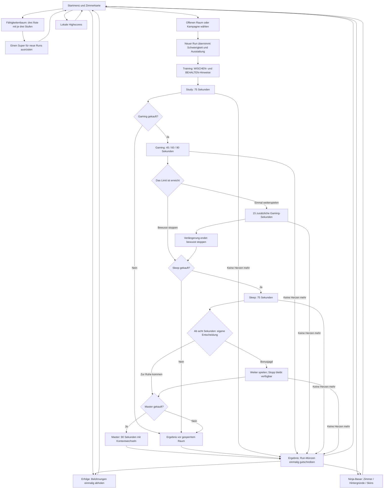
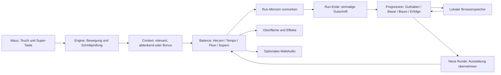
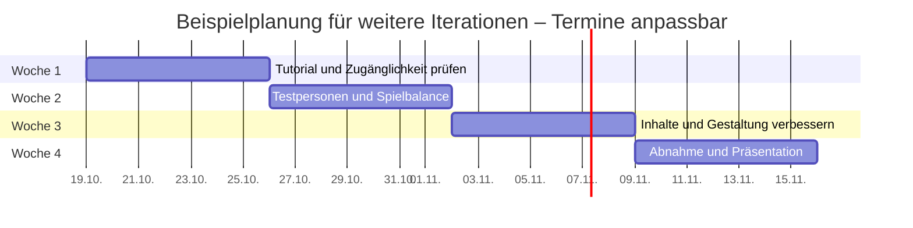

# Notification Ninja: Ablauf und Weiterentwicklung

Diese Übersicht dokumentiert den Spielablauf von Version 1.2.0 und ordnet die technischen Aufgaben. Der Zeitplan am Ende ist ein **anpassbares Beispiel für Weiterentwicklung**. Seine Daten sind keine vereinbarte Projektfrist.

## Ablauf der Bildschirme

Das Diagramm zeigt die Kampagne. Das Schulzimmer ist frei; Gaming-Zimmer kostet 35, Schlafzimmer 75 und Balance Master 120 Münzen, jeweils nach dem Kauf des vorherigen Raums. Vor einem noch gesperrten Raum endet der Run mit `result: locked`; die verdienten Münzen werden einmal gutgeschrieben. Erst mit allen vier Räumen führt die Kampagne durch den ganzen Tag. Einzelmodi starten den gewählten offenen Raum direkt. Ein gespeicherter Run setzt seine bestehende Ausstattung fort. Im Startmenü gibt es Entspannt mit fünf Herzen, Normal mit vier und Profi mit drei Herzen.

Die Phase bestimmt, welche Dinge helfen und welche ablenken. Klassenzimmer, Gaming-Zimmer und Schlafzimmer haben eigene Hintergründe, passende Objekte und eigene Musik. WISCHEN-/BEHALTEN-Hinweise erscheinen nur im Training. Danach zeigen Objektnamen, Formen und das aktuelle Kontextziel die Situation; eine Antwortmarkierung entfällt. Gaming- und Schlafentscheidungen werden über sichtbare Schaltflächen getroffen. Pause unterbricht die laufende Simulation und die Musik.

Ein falscher Schnitt und eine verpasste Ablenkung kosten jeweils ein Herz, sofern kein Schild schützt. Das Tempo steigt innerhalb des Schwierigkeitsgrads bis zu einer festen Grenze. Die Leveluhr läuft weiterhin normal. Alle 20 aktiven Bonussekunden bringt eine sechssekündige Münzregen-, Combo-Party- oder Fokus-Welle Abwechslung. Während eines Kontextwechsels wartet die Bonusuhr auf das Ende der bisherigen Flugobjekte; die normale Leveluhr läuft weiter. Richtige Entscheidungen, Bonusobjekte, Flow und Supers belohnen mit Punkten, Animationen und Klangfolgen.

## Vier technische Systeme

| System | Aufgabe | Prüffrage |
| --- | --- | --- |
| Engine | Objekte bewegen, Wischsegmente erfassen und das Tempo begrenzen | Trifft die tatsächliche Bewegung das Objekt, und bleiben Flugbahnen bei höherem Tempo bedienbar? |
| Context | Objekte im aktuellen Lern-, Gaming- oder Schlafkontext bewerten | Behält ein bereits fliegendes Objekt beim Kontextwechsel seine bisherige Bewertung? |
| Balance | Herzen, Combo, Flow, Bonuswellen, Power-ups, Supers und Zeitentscheidungen berechnen | Kosten beide Fehler ein Herz, fängt ein Schild nur einen Fehler ab und pausieren alle Timer? |
| Progression | Münzen, Zimmerkarte, Hintergründe, Fähigkeiten, Erfolge, Skins und Highscores lokal verwalten | Werden Run-Münzen einmal gutgeschrieben, Raumvoraussetzungen geprüft und Erfolgsbelohnungen nur einmal abgeholt? |

`game.js` verwaltet die laufende Simulation und die Abrechnung eines Runs. `progression.js` enthält Schwierigkeit, Raum- und Hintergrundkatalog, neun Fähigkeiten und zwölf Erfolge sowie die Prüfungen für Käufe, Ausrüstung und Belohnungsabholung. Die drei Äste kosten je 12, 25 und 45 Münzen; eine Stufe setzt die vorige desselben Astes voraus. Ein neuer Run übernimmt die freigeschalteten passiven Fähigkeiten, den ausgewählten Super und die Hintergrundauswahl je Kontext. Master nutzt beim Wechsel die Ausstattung des jeweiligen Kontexts. Einkäufe verändern diesen gespeicherten Satz im laufenden Run nicht. Papiergarten kostet 60 Münzen für Study, Pixelbucht 85 für Gaming und Mondinseln 110 für Sleep; der zugehörige Raum muss vorher offen sein. Die drei Grundkulissen sind enthalten. Der Hintergrundkauf und das anschließende Auswählen sind getrennte Schritte; ein Raumkauf startet keine Runde. Hintergrund- und Skinvorschauen zeigen die Motive, Farbpaletten und Wischspuren der Auswahl.

Der Super lädt sich durch richtige Entscheidungen und kann bei 100 Prozent über Schaltfläche oder Leertaste aktiviert werden. Zeitzauber verlangsamt Objekte acht Sekunden lang, Rettungsschirm schützt vor einem Fehler und Aufräum-Wirbel entfernt ausschließlich Ablenkungen. Die Leveluhr wird durch diese Fähigkeiten nicht verlängert.

Spielregeln werden getrennt von Darstellung und Eingaben überprüft. Die Audio-Komponente erzeugt Musik und Effekte lokal und öffnet ihren AudioContext erst nach einer Nutzeraktion. Mit eingeschaltetem Ton startet die Musik beim Spielen. Study verwendet Zupfklänge mit 100 BPM, Gaming einen Marimba-Groove mit 116 BPM und Sleep eine Spieluhr mit 80 BPM. Master folgt musikalisch dem aktuellen Kontext. Die Stimmenzahl ist auf 32 begrenzt; Pause stoppt geplante Musiknoten und Stummschalten räumt alle Stimmen auf.

## Beispiel für Weiterentwicklung: vier Wochen

Die vorhandene Grundlage umfasst Spielablauf, Kontextregeln, Fortschritt, Oberfläche und lokale Paketierung. Der folgende Plan zeigt mögliche nächste Iterationen auf dieser Grundlage. Beginn und Umfang lassen sich an einen tatsächlichen Semesterplan anpassen.

| Woche | Fokus | Reviewbares Ergebnis |
| --- | --- | --- |
| 1 | Verständlichkeit und Zugänglichkeit | Feedback zu Tutorial, Symbolen, Kontrasten und Bedienung; priorisierte Verbesserungen |
| 2 | Spielbalance mit Testpersonen | Nachvollziehbare Anpassungen an Tempo, Herzen, Münzverdienst und Fähigkeiten |
| 3 | Inhalte und Gestaltung | Zusätzliche Objekte, Skins und audiovisuelle Varianten nach Tests |
| 4 | Abnahme und Präsentation | Geprüfter Browser-Build, vollständiges ZIP und dokumentierte Demonstration |

Pro Iteration: konkrete Änderung festlegen, Regeln prüfen, Browser- und Touch-Bedienung überprüfen, neu bauen und paketieren und anschließend das Ergebnis gemeinsam bewerten. Die Zeitplanblöcke beschreiben mögliche zukünftige Arbeit; sie behaupten keine bereits durchgeführten Nutzertests.
